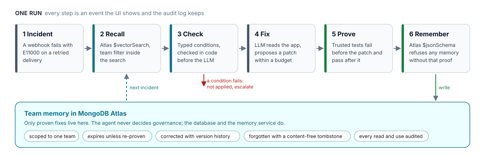

<div align="center">

# Traceback

**Agent memory with receipts.**

Traceback is a debugging agent whose memory you can govern. It fixes a failing webhook, proves the
fix with tests it cannot see, and only then remembers it. The memory is searched with MongoDB Atlas
Vector Search, fenced to the team that earned it, checked in code before reuse, and it expires,
can be corrected, and can be forgotten for good.

[Results](evals/results/results.md) · [Demo runbook](docs/DEMO.md) · [Governed memory](docs/README_P2.md) · [Test world and runner](docs/README_P3.md) · [Design](docs/TEAM_GUIDE.md)

[](https://github.com/YaCnDehfuli/TraceBack/actions/workflows/ci.yml)
[](pyproject.toml)
[](memory/store.py)
[](docs/SUBMISSION.md)



</div>

## The problem in one scene

Dana fixed this bug in March and left in June. At 3 a.m. the same alert pages Sam. The fix exists,
but it lives in a closed chat thread. An agent with memory could have it ready, but an agent that
saves whatever it "learned" can save a wrong fix, show it to the wrong team, and keep it forever.

Traceback saves a fix only after the tests prove it, and every later use of that memory leaves a
receipt: who could see it, why it applied (or didn't), and what happened to it afterwards.

## What memory changed

Cases B, B2 and B3 are the same bug as case A, reported in different words. Each was run 3 times
under three arms: **no memory**, a **placebo** (an unrelated memory of matched length, injected
through the same prompt block), and the **real** memory earned on case A. Same model
(`claude-sonnet-5-5`), same budget, the real test runner, and a throwaway Atlas database per run.

| 27 runs on `45afa59` | off | placebo | real |
|---|---:|---:|---:|
| **fixed on the first attempt** | **0/9** | **0/9** | **9/9** |
| fixed at all | 9/9 | 9/9 | 9/9 |
| attempts per run | 2 | 2 | 1 |
| tool calls per run | 5 | 5–6 | 4 |

Without memory, every first fix was the generic one and failed the team's reconciliation test,
because the rule it needs (`ledger.mark_replayed`) is written only in an operations document. With
the real memory, the fix was right the first time in every run. The placebo did not help, so the
gain comes from the memory's content, not from a longer prompt. These are raw counts on one bug
family with N=3 per case and arm; we claim no rates and no significance.
[Full table and per-run IDs](evals/results/results.md)

The look-alike case C (the unique index is on `customer_id`, not `provider_event_id`) finds the
memory and is refused by its conditions: **4/4 runs escalated** to a human, nothing was verified or
saved. [Case C runs](evals/results/case_c/README.md)

## Five verbs, each enforced below the agent

| Verb | What you see | What enforces it |
|---|---|---|
| **Earn** | A fix becomes memory only if the trusted tests failed before it and pass after it. | Atlas `$jsonSchema` validator with `validationAction: "error"`. A write without that proof is rejected by the database: *"Memory refused: no proof."* |
| **Reuse** | A fresh session recalls the memory, checks its two conditions, and the UI highlights the line that came from memory. | `$vectorSearch` recall, then typed conditions (`dup_key_field`, same event id on both deliveries) checked in code before the LLM is called. |
| **Refuse** | A similar bug gets *"Not applied: duplicate key is `customer_id`; this memory requires `provider_event_id`."* | The same code checks. The near miss is recorded; the memory is not blamed or renewed. |
| **Fence** | Another team's engineer asks the same question and sees nothing. | `tenantId` and `readableBy` are pre-filters **inside** `$vectorSearch`, so other teams' memories are never candidates. Every hit is re-read with the same filter. |
| **Forget** | An admin deletes a memory with a reason; the rerun loses the remembered line. | Every version is removed, a content-free tombstone stays, and the audit log records who and why. |

Also built: **correction with version history** (version 2 supersedes version 1, both kept), a
**Stale** chip when the code a memory was proven against has changed, expiry that is renewed only
when a memory is proven again, and a `memory_audit` collection with an event for every read and use.

## How a run works

The incident's error is parsed in code (`agent/observe.py`): the duplicate-key field, the unique
index, and whether the retried deliveries carry the same event id. Those facts, and nothing the
reporter wrote, are what gets embedded with `voyage-4-lite`, for the stored memory and for the query
alike. In our measurements true repeats score **0.952**, the look-alikes 0.927 to 0.939, and the
best of 20 labelled distractor memories 0.778, so a cutoff of 0.83 keeps every real candidate and
drops every distractor. Similarity only finds candidates: **the team filter decides who may see a
memory, and the conditions decide whether it applies.**

The agent loop (`agent/loop.py`) then gives the model the incident, the app's files and, if one
applies, the memory's cause and proven fix. It has 8 tool calls, 2 fix attempts and 120 seconds. A
proposed fix runs in the sandboxed runner (`runner/sandbox.py`): a temporary copy of the app, a
separate `pytest` process, a timeout and no secrets. The memory service, not the agent, decides what
happens to the memory: renewed, disputed, recorded as a near miss, or promoted. Every step is a
run event saved to Atlas, which the web UI follows live, and an escalated run ends with a plain-text
handoff a human can paste into a ticket.

## Run it

Needs [uv](https://docs.astral.sh/uv/), an Atlas cluster, a Voyage key, an Anthropic key, and a
local MongoDB for the practice app that the test runner uses.

```bash
git clone https://github.com/YaCnDehfuli/TraceBack.git && cd TraceBack
uv sync
cp .env.example .env              # Atlas, Voyage, LLM keys; set MONGODB_DB=traceback_demo; never commit it
docker run -d --name fixture-mongo -p 27018:27017 mongo   # the practice app's database
uv run python scripts/check_env.py                    # checks every connection
uv run python scripts/atlas_setup.py --db traceback_demo  # collections, proof validator, vector index
uv run python scripts/demo_reset.py                   # policies, the Earn memory, 20 labelled distractors
uv run python scripts/demo.py                         # API and UI on http://localhost:8000
```

In the UI, `Shift+2` starts a live Reuse run, `Shift+3` the look-alike, `Shift+4` a run as the
Platform team (Payments' memory stays fenced off), `F` the fence view, and `0` a recorded run that
needs no network. The full key map is in the [demo runbook](docs/DEMO.md).

| Command | What it does |
|---|---|
| `uv run python -m agent.run --case B --team payments` | One investigation in the terminal, event by event |
| `uv run python scripts/db_trace.py --case B` | Every Atlas command and Voyage call recall makes, as both teams |
| `uv run python -m evals.run_ablation --dry-run` | The off / placebo / real experiment plan (drop `--dry-run` to run it) |
| `uv run python scripts/embed_separation.py` | How well the recall text separates true repeats from look-alikes |
| `uv run pytest -m "not atlas"` | Tests that need no cloud services (CI runs these plus ruff) |

## Limits

- **Synthetic incidents.** Two small practice apps and hand-written logs. The `E11000` errors are
  real and the tests really run, but this is not production data.
- **One bug family.** The conditions are a fixed typed list for duplicate-key retries. Other bugs
  need their own parser and condition fields; the proof gate, fence, expiry and deletion stay.
- **Proof is only as strong as the tests.** Case C first exposed a weak test that let a bad fix
  pass; we strengthened the tests, not the memory code.
- **Corrections reach the agent as text.** A memory's narrowed `excludes` are shown to the model,
  but only the two coded conditions decide applicability.
- **Demo identities.** API keys map to a team and role from `.env`; there is no real login.
- **The audit log is append-only by convention**, not yet by a database role. Seeded distractor
  memories are labelled `seeded: true`.

## Repository map

| Path | Role |
|---|---|
| [`agent/`](agent/) | Error parsing, condition checks, the agent loop, LLM client, budgets |
| [`api/`](api/) | FastAPI: incidents, runs, live run events, team-scoped access |
| [`memory/`](memory/) | Atlas schema and proof gate, recall, governance outcomes, audit, forget, correction |
| [`runner/`](runner/), [`trusted_tests/`](trusted_tests/) | Sandboxed verification and the tests the agent never sees |
| [`fixture_app/`](fixture_app/), [`cases/`](cases/) | Two teams' practice webhook apps and seven incident cases |
| [`evals/`](evals/) | The memory experiment and its committed results |
| [`web/`](web/) | Run view, memory cards, slides |
| [`contracts/`](contracts/) | Shared data shapes and fakes used by every test |

## Team

Built in one day at **Agents in Context Toronto** (MongoDB), November 14, 2026, for **Challenge 2:
Memory You Can Govern**, with AI coding assistants (Claude Code).

**Yasin Dehfouli** ([YaCnDehfuli](https://github.com/YaCnDehfuli)): agent loop, API and experiment ·
**Elham Razi** ([elhamrazi](https://github.com/elhamrazi)): governed memory on Atlas ·
**Sepehr** ([SepehrAsh](https://github.com/SepehrAsh)): test world, runner, UI and demo.
